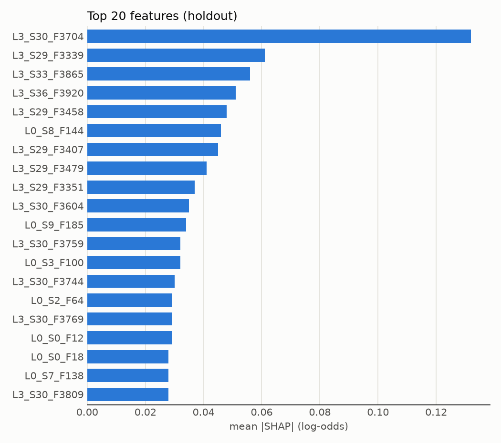
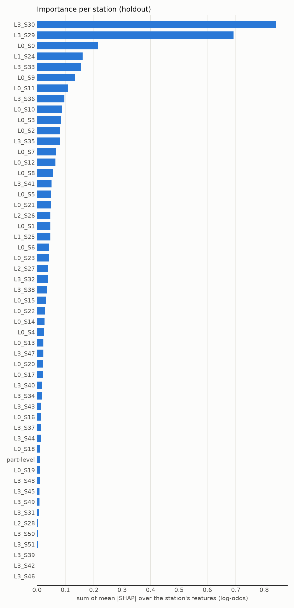

# Explainable failure prediction on the Bosch production line

A small, reproducible pipeline that predicts internal failures of parts on the Kaggle
[Bosch Production Line Performance](https://www.kaggle.com/competitions/bosch-production-line-performance)
data and explains the predictions with TreeSHAP: which features and stations drive risk overall,
why single parts were flagged or missed, and which groups ("slices") of high-risk parts share the
same explanation. Optionally, an LLM turns each slice into three sentences for a production
engineer, and a deterministic check flags any name or number it did not take from the data.

## Problem

About 1.18 million parts pass through 4 production lines with 52 stations. Each part has
anonymised measurements (`L{line}_S{station}_F{n}`), timestamps (`..._D{n}`) and categorical
values, plus the target `Response` (1 = failed quality control, roughly 0.6% of parts). The
competition metric is the Matthews correlation coefficient (MCC), which depends on a decision
threshold, so the threshold is tuned and reported along with threshold-free metrics
(PR-AUC, ROC-AUC).

## Prerequisites

- [uv](https://docs.astral.sh/uv/) (installs Python 3.12 from `.python-version` if needed).
- A Kaggle account. **Accept the competition rules** at
  <https://www.kaggle.com/competitions/bosch-production-line-performance/rules>; the download is
  refused otherwise. The data may not be redistributed, so it is never part of this repository.
- A Kaggle API token: Kaggle > Settings > API > create a new token, then either
  `export KAGGLE_API_TOKEN=...`, save the downloaded `kaggle.json` to `~/.kaggle/kaggle.json`, or
  copy `.env.example` to `.env` (git-ignored), fill it in and run every command as
  `uv run --env-file .env bosch-xai ...`.
- About 15 GB of free disk space for the training CSVs and 16 GB of RAM or more (see
  [Resource use](#resource-use)).
- Optional, for `explain --llm`: an Anthropic API key in `ANTHROPIC_API_KEY`.

## Setup

```bash
git clone https://github.com/antonpstahl/xai-line-performance.git
cd xai-line-performance
uv sync            # add --extra llm for the optional LLM summaries
uv run pytest      # runs on tiny synthetic data, no download needed
```

## How to run

```bash
uv run bosch-xai download          # folders + data into data/raw (skips what is already there)
uv run bosch-xai prepare --sample  # all failures + 10% of other parts; omit --sample for all
uv run bosch-xai train             # CV, MCC threshold, time holdout -> models/, reports/metrics.json
uv run bosch-xai explain           # plots, local explanations, failure slices -> reports/

# optional: plain-language slice summaries, model from ANTHROPIC_MODEL (default claude-haiku-5-5)
uv run --extra llm bosch-xai explain --llm
```

All commands work relative to the repository root. Outputs:

| path | content |
|---|---|
| `data/raw/` | `train_numeric.csv`, `train_date.csv`, `train_categorical.csv` (git-ignored) |
| `data/processed/features.parquet` | feature table (git-ignored) |
| `models/model.txt` | final LightGBM model (git-ignored) |
| `reports/metrics.json` | metrics, threshold, config and package versions |
| `reports/top_features.png`, `reports/station_importance.png` | global importance |
| `reports/local_explanations.md` | one true positive, false positive and false negative (git-ignored) |
| `reports/slices.json`, `reports/slices.md` | failure slices, with LLM text and check if `--llm` (JSON git-ignored) |

## Results

> **Pending.** This table is filled from `reports/metrics.json` after the first run on the real
> data. No numbers are shown until then; nothing here is estimated or copied from elsewhere.

| run | parts | threshold | OOF MCC | holdout MCC | holdout PR-AUC | holdout ROC-AUC |
|---|---|---|---|---|---|---|
| `--sample` | pending | pending | pending | pending | pending | pending |

The out-of-fold (OOF) scores come from 5-fold CV on the earlier 80% of parts; the holdout is the
latest 20% by start time, scored with the threshold chosen on OOF predictions. Metrics from
`--sample` are not comparable to the full data: sampling raises the failure rate about tenfold.

## Figures

Generated by `explain` from the holdout set:




## Resource use

Measured with `/usr/bin/time -l` on an Apple M4 Pro (14 cores, 24 GB RAM) with a **synthetic
stand-in** of the real files: same row count (1,183,747), same column naming, about 2,100
columns, mostly empty, and 11 GB of CSV, about twice the size of the real numeric and date files.
These figures show the memory profile of the code. They are not results, and training on the real
data needs more boosting rounds, so it will take longer.

| step | `--sample` time | `--sample` peak RSS | full time | full peak RSS |
|---|---|---|---|---|
| prepare | 11 s | 7.0 GB | 12 s | 8.5 GB |
| train | 33 s | 5.3 GB | 2 min | 8.3 GB |
| explain | 2 s | 2.2 GB | 13 s | 8.8 GB |

## Design decisions

- **Numeric and date files only.** The categorical file is very sparse: 97% of the cells in its
  2,140 columns are empty (measured on the first 200,000 parts). Parsing it costs much memory and time for little
  expected signal, so it is downloaded (as specified) but not used. It would be a separate
  experiment.
- **One timestamp per station.** Checked on the first 200,000 parts: in 50 of the 52 stations all
  date columns of a visit hold the same value, so the row-wise minimum loses nothing (it also
  ignores missing entries). The exceptions are L1_S24 (median spread 0.03 time units, small
  against a median part duration of 3.7) and L1_S25 (median 0.12, but 8.6 at the 90th
  percentile); there the minimum keeps the entry time and drops the time spent inside the
  station. From the station times
  come the part's start, end and duration and one visited flag per station: the route through the
  line is information in itself.
- **No "magic" features.** Features built from neighbouring Ids (row order) were strong in the
  competition but describe how the data was exported, not the physics of a part. They are left out
  on purpose so that every explanation refers to measurements, times or routes.
- **Polars, lazy and float32.** CSVs are scanned lazily with an explicit float32 schema (no type
  inference, half the memory of float64) and written straight to parquet.
- **Validation in two layers.** Stratified 5-fold CV gives out-of-fold predictions for choosing
  the threshold without touching the holdout. The holdout is the latest 20% of parts by start time,
  which checks that the model works on later production, not just on shuffled rows. Parts without
  any timestamp stay in the development set.
- **MCC threshold on OOF predictions only.** Every distinct score is evaluated in one vectorised
  pass (cumulative true/false positives), so the optimum is exact rather than taken from a grid.
- **LightGBM with early stopping on PR-AUC.** With about 0.6% positives, PR-AUC reacts to changes
  in the ranking of rare failures where log loss hardly moves. The final model is refit on all
  development parts with the mean best iteration of the folds. NaN is passed as missing, which is
  what an unmeasured feature means here.
- **Reproducible.** One seed (42) for sampling, folds, LightGBM and k-means;
  `deterministic=True` with `force_row_wise=True`; `uv.lock` pins every package, and
  `metrics.json` stores the configuration and package versions with the results.
- **TreeSHAP from LightGBM itself.** `predict(..., pred_contrib=True)` computes exact TreeSHAP in
  log-odds units without the `shap` package. Station importance is the sum of mean |SHAP| over a
  station's features (timestamp and visited flag included); start, end and duration count as
  "part-level".
- **Local explanations.** The highest-scoring true positive, false positive and false negative of
  the holdout: the clearest hit, the most confident false alarm and the miss closest to the
  threshold.
- **Failure slices in SHAP space.** High-risk parts are those flagged by the threshold or in the top
  2% of holdout scores, so a slice can contain flagged and unflagged parts and precision differs
  from failure rate. Clustering their SHAP vectors (k-means, k = 5) groups parts by *why* the model
  rates them risky instead of by raw, mostly missing measurements. Each slice lists size, failures,
  failure rate, precision, and the features and stations with the largest mean SHAP (the
  strongest push towards failure).
- **LLM as an optional, checked layer.** Only the slice JSON is sent; the model is asked for three
  sentences. A deterministic check then requires every feature or station name to appear in the
  JSON and every number to equal a JSON value, as written or as a percentage, rounded to the
  digits shown in the text. Signs are ignored because the text says "raises" or "lowers".
  Violations are printed under the slice in `slices.md`.
- **Download.** kagglehub writes directly into `data/raw` via `output_dir`, so the 14 GB are not
  duplicated in its cache and no symlinks are needed. Only the three training zips are extracted;
  the zips are kept so a rerun does not download again.
- **Small on purpose.** About 490 non-blank lines in `src/` (575 with blank lines), functions
  only, argparse instead of a config framework. `numpy` is used directly but not declared, since
  LightGBM and scikit-learn both depend on it.

## Limitations

- SHAP explains the model, not the process. A high SHAP value says the model relies on a feature,
  not that the feature causes failures; correlated features share credit in a way that can look
  arbitrary.
- Station importance adds up features, so stations with many measurements can look more
  important than stations with a few strong ones.
- k = 5 slices is a fixed, readable choice, not a tuned one; slices are descriptive.
- Early stopping uses each validation fold, which makes OOF scores slightly optimistic; the
  time holdout is not affected.
- Station L1_S25 is reduced to its entry time although parts spend measurable time inside it
  (see Design decisions); a per-station duration would keep that information.
- The faithfulness check is lexical. It catches invented names and numbers, but not a wrong
  relation between correct ones, numbers written as words, or vague claims.
- Results on `--sample` overstate precision because failures are about ten times more frequent
  there than in production.

## Layout

```
src/bosch_xai/
  cli.py      argparse entry point (bosch-xai)
  data.py     paths, download, feature preparation
  model.py    CV, threshold search, time holdout, metrics
  explain.py  TreeSHAP plots, local explanations, failure slices
  llm.py      optional Anthropic summaries and faithfulness check
tests/        pytest on tiny synthetic data
```

## Data use and license

The data belongs to Bosch and is used under the
[Kaggle competition rules](https://www.kaggle.com/competitions/bosch-production-line-performance/rules).
It is not redistributed: raw and processed data, models and every report that contains
individual parts (`local_explanations.md`, `slices.json`) are git-ignored. Only aggregate
results are committed: metrics, importance plots and slice summaries.

Code: MIT (see `LICENSE`), which is also the license the competition rules attach to publicly
shared code.
